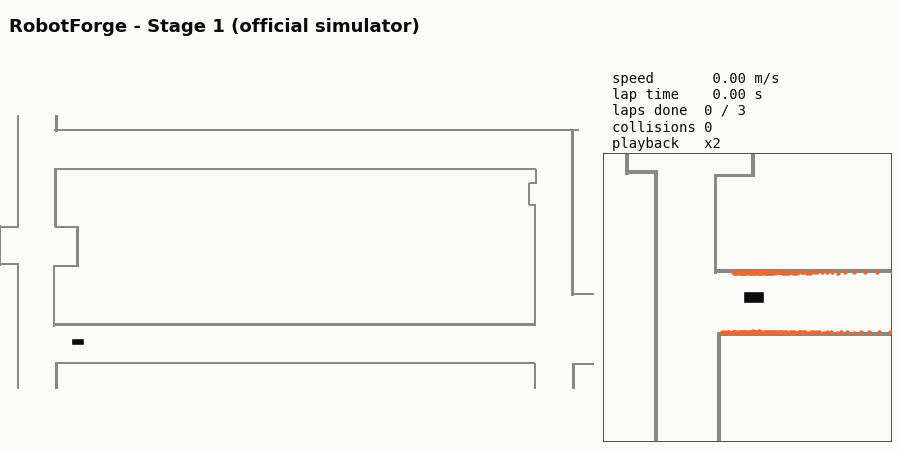

# Team RobotForge — CIE-KFUPM F1TENTH Autonomous Racing Competition

Ameen Ur Rehman (ID 202527430)



Official simulator, Stage 1 preset: 3 timed laps in **44.40 s with 0 collisions**
(official race monitor).

The controller package is [`src/robotforge_controller`](src/robotforge_controller/README.md).
Its README has the interface, dependencies, build steps, stage presets, maximum speed and
more demo runs.

```bash
ros2 run robotforge_controller controller
```
